<div align="center">


# MDAura

**Markdown, read the way it was meant to look.**

Open a `.md` file and get a proper document: an outline, search, highlighted code, readable tables and Mermaid diagrams that draw themselves in. Marp files become slide decks. Export to Word, PDF or PowerPoint. Everything runs in your browser, so your files never leave your machine.

[](https://nextjs.org)
[](https://react.dev)
[](https://nodejs.org)
[](https://www.typescriptlang.org)
[](https://tailwindcss.com)
[](LICENSE)

</div>

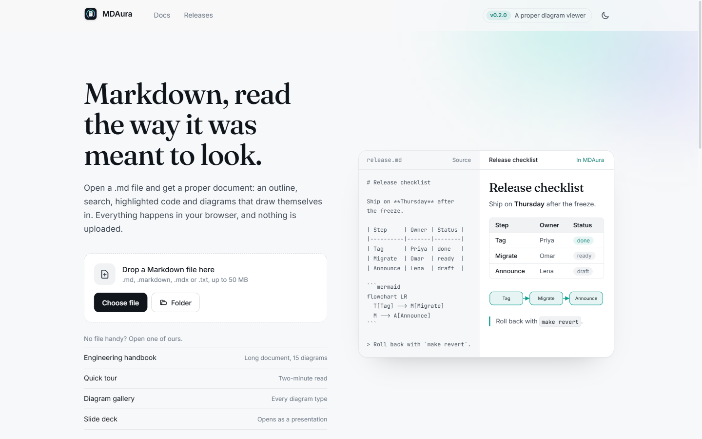

## Why

AI tools are very good at writing Markdown: design docs, runbooks, specs, release plans. Reading that Markdown, or handing it to someone who doesn't live in a code editor, is still awkward. MDAura is the missing reader: drop the file in and get a document you would be happy to present.

## Features

### Reader

- **Outline** of every heading, which tracks your scroll position and shows how far through the document you are.
- **Search** with <kbd>Ctrl</kbd> <kbd>K</kbd>. Results show the section each match is in and jump straight to it.
- **Focus mode** (<kbd>.</kbd>) hides the outline and fades the toolbar.
- **Text size** control, deep links to any heading, a reading progress bar and a reading-time estimate.
- **GitHub-flavoured Markdown**: tables with column alignment, task lists, footnotes, `<details>`, `<kbd>`, syntax highlighting for 35+ languages.
- **Images** from the web, embedded as data URLs, or from a folder you open, with a full-screen lightbox.
- **Light and dark themes**, a print stylesheet, and layouts that work down to phone width.

### Diagrams

Every Mermaid diagram (flowchart, sequence, class, state, ER, Gantt, pie, mind map, git graph, timeline, journey, quadrant, XY chart) is drawn with a reveal animation: boxes fade in, connectors draw from start to end, and a light keeps flowing along flowchart edges.

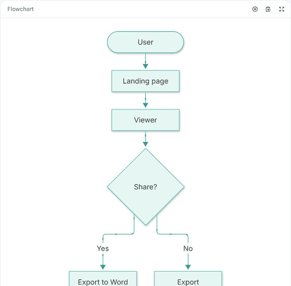

Open any diagram **full screen** to explore it properly:

- drag to pan, scroll to zoom toward the pointer, double-click to zoom in
- <kbd>F</kbd> fit to screen, <kbd>0</kbd> actual size, <kbd>R</kbd> replay, <kbd>S</kbd> show source
- download as **SVG** or **PNG**, or copy the Mermaid source

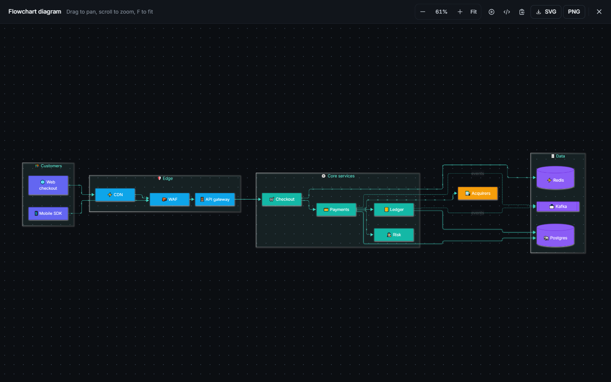

### Presentations

A Markdown file with `marp: true` in its front matter opens as a 16:9 slide deck with keyboard navigation, and exports to PowerPoint.

### Export

| Format | How |
|---|---|
| Word (`.docx`) | Headings, lists, tables, code, links and images. Each diagram is rendered as a picture. |
| PDF | Your browser's print dialog, with a print stylesheet that hides the chrome. |
| PowerPoint (`.pptx`) | For Marp decks. |
| Markdown | The original file. |

All exports are built in the browser.

### Documentation and release notes

The site includes [documentation](content/docs) rendered by MDAura itself, and a release-notes page driven by [`lib/releases.ts`](lib/releases.ts).

## Screenshots

| Reader (light) | Reader (dark) |
|---|---|
| 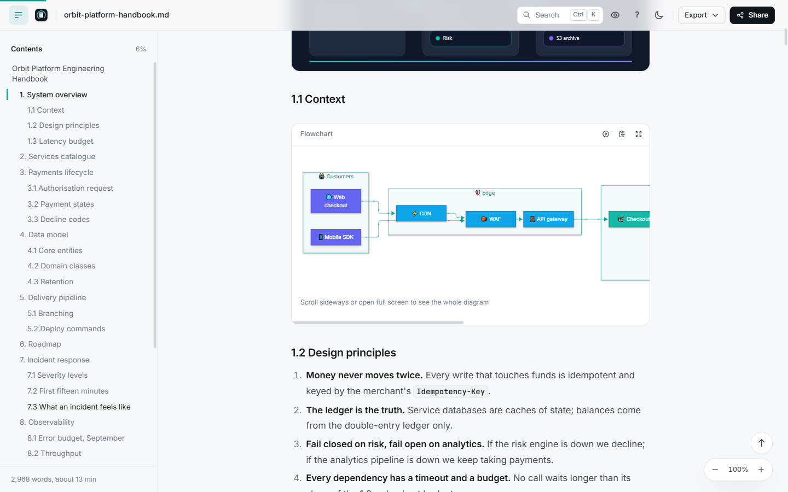 | 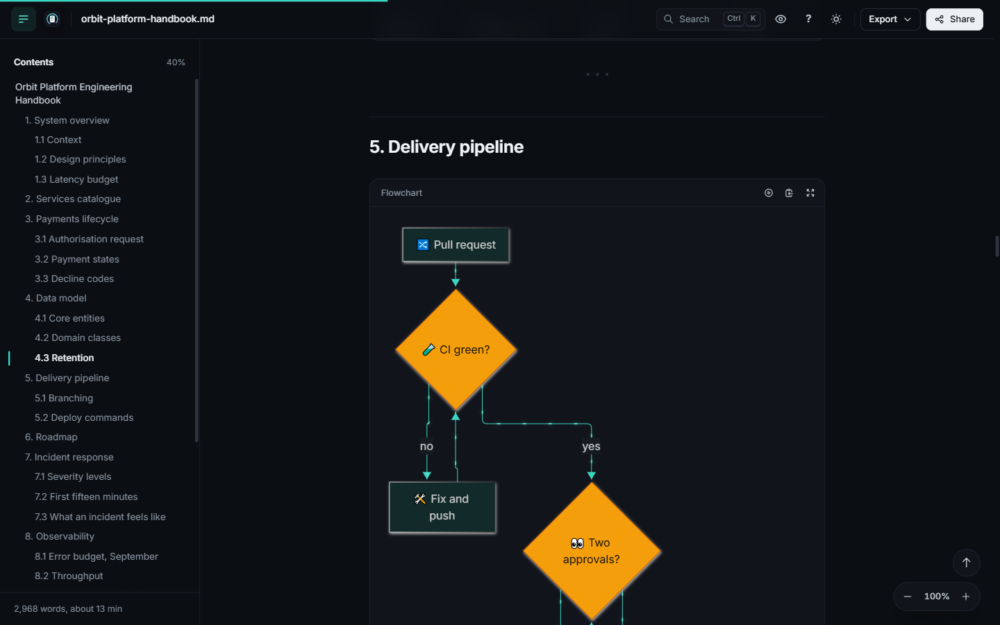 |

| Documentation | Release notes |
|---|---|
| 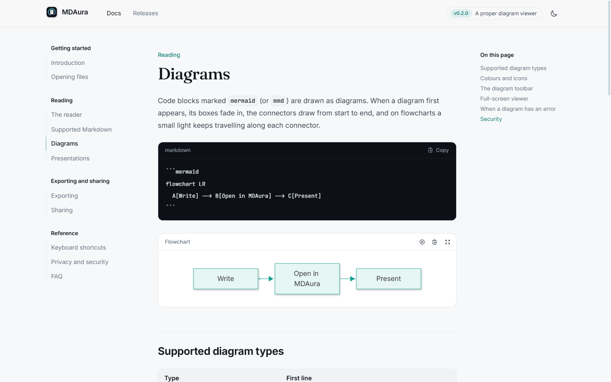 | 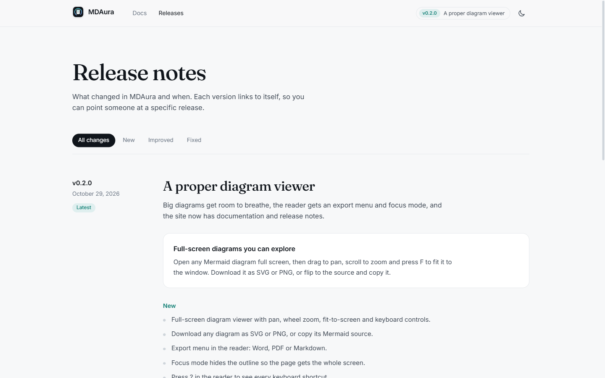 |

| Dark home page | Share links, coming soon | Phone |
|---|---|---|
| 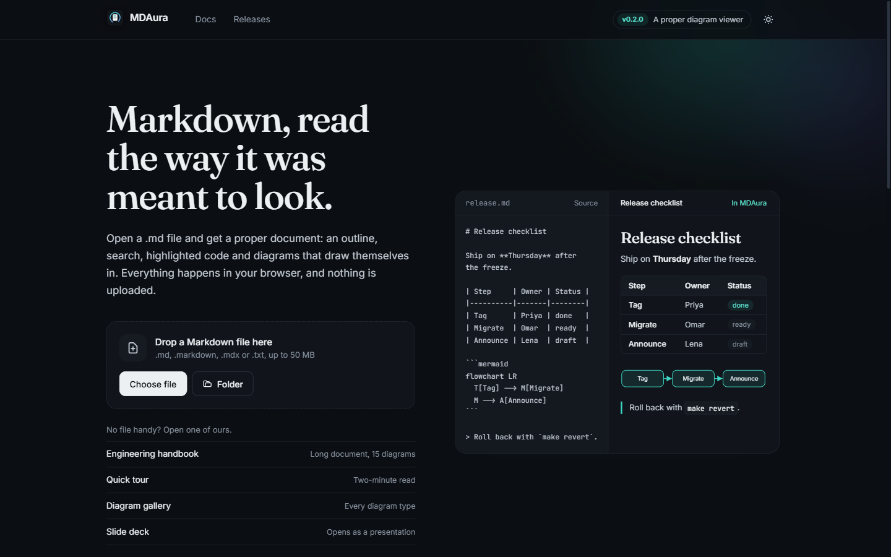 | 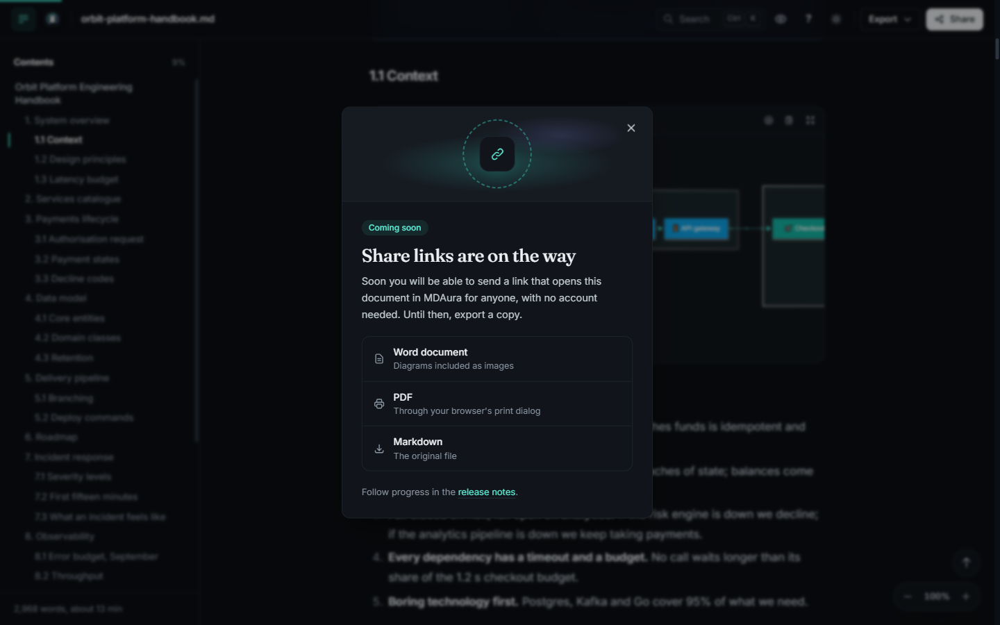 | 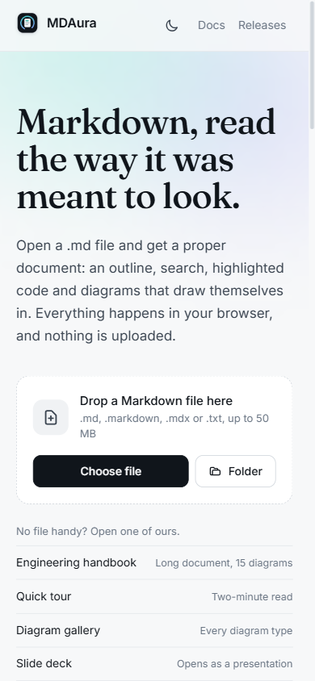 |

## Getting started

Requires **Node.js 26 or later** (see `.nvmrc`; run `nvm use` if you use nvm).

```bash
git clone https://github.com/sunilbhara/mdaura.git
cd mdaura
npm install
npm run dev
```

Open <http://localhost:3000>, then drop a Markdown file or pick one of the samples on the home page. The **Engineering handbook** sample is a long document with 15 diagrams, tables, code and images, useful for trying everything at once.

| Script | What it does |
|---|---|
| `npm run dev` | Start the development server |
| `npm run build` | Create a production build |
| `npm start` | Serve the production build |
| `npm run lint` | Run ESLint |

There are no environment variables and no backend: the app is fully static apart from the docs pages, which are prerendered at build time.

## How it works

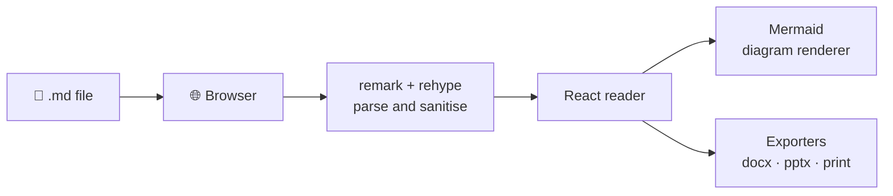

- **Rendering:** `react-markdown` with `remark-gfm`, `rehype-raw` and `rehype-sanitize`. A small rehype plugin gives every heading a stable id that the outline uses.
- **Diagrams:** Mermaid renders are queued one at a time because Mermaid keeps global state. The reveal animation only changes opacity, filters and stroke dashes, never the `transform` Mermaid uses for layout.
- **Exports:** the Word exporter walks the Markdown syntax tree (`unified` + `remark-parse`) and builds a `docx` document. Diagrams are rendered to SVG and rasterised on a canvas.
- **State:** the open document lives in a small external store, mirrored to `sessionStorage` so a reload keeps it.

## Project structure

```text
app/                 Routes: home, /viewer, /docs/[slug], /releases
components/          Reader, diagrams, viewer chrome, site header and footer
  diagram/           Full-screen diagram canvas
  viewer/            Outline, find, export menu, share and shortcuts dialogs
content/docs/        Documentation pages in Markdown
hooks/               Outline parsing and active-heading tracking
lib/
  export/            Word, PowerPoint and Marp deck parsing
  markdown/          Diagram rendering, image handling, heading slugs
public/samples/      Sample documents used on the home page
docs/screenshots/    Images used in this README
```

## Security

MDAura treats every document as untrusted:

- HTML is sanitised before rendering. Scripts, iframes, forms, styles, `javascript:` URLs and inline event handlers are removed.
- Mermaid runs with `securityLevel: "strict"`.
- External links open with `rel="noopener noreferrer"`.

If you find a security problem, please report it privately through GitHub's **Report a vulnerability** option on this repository rather than opening a public issue.

## Roadmap

- [ ] Share links: send a link that opens a document in MDAura, no account needed for the reader
- [ ] Render diagrams only when they scroll into view, for faster loading of long documents
- [ ] Images and diagrams in PowerPoint export
- [ ] Automated tests (Vitest, Playwright)

## Contributing

Issues and pull requests are welcome. Before opening a pull request, run `npm run lint` and `npm run build`.

## License

[MIT](LICENSE) © 2026 Sunil Bharati
