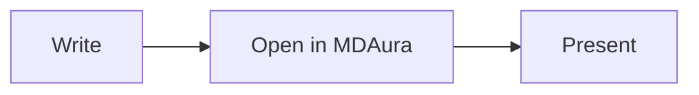
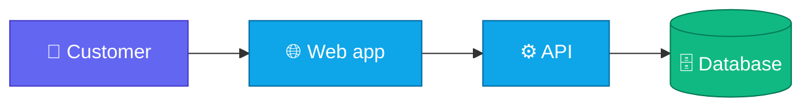

# Diagrams

Code blocks marked `mermaid` (or `mmd`) are drawn as diagrams. When a diagram first appears, its boxes fade in, the connectors draw from start to end, and on flowcharts a small light keeps travelling along each connector.

````markdown

````


## Supported diagram types

| Type | First line |
|---|---|
| Flowchart | `flowchart LR` or `graph TD` |
| Sequence | `sequenceDiagram` |
| Class | `classDiagram` |
| State | `stateDiagram-v2` |
| Entity relationship | `erDiagram` |
| Gantt | `gantt` |
| Pie | `pie` |
| Mind map | `mindmap` |
| Git graph | `gitGraph` |
| Timeline | `timeline` |
| User journey | `journey` |
| Quadrant | `quadrantChart` |
| XY chart | `xychart-beta` |

## Colours and icons

Use `classDef` to colour nodes, and emoji in labels for quick icons.



## The diagram toolbar

Each diagram has three buttons above it:

| Button | What it does |
|---|---|
| Replay | Plays the reveal animation again |
| Copy | Copies the Mermaid source |
| Full screen | Opens the diagram viewer |

You can also select the diagram itself to open it full screen.

## Full-screen viewer

The viewer opens with the diagram fitted to your window, on a dotted canvas you can move around.

- **Pan** by dragging, with the arrow keys, or by scrolling sideways on a trackpad.
- **Zoom** with the scroll wheel or a pinch, toward the pointer. Double-click to zoom in, shift and double-click to zoom out.
- **Fit** with <kbd>F</kbd>, and see the diagram at **actual size** with <kbd>0</kbd>.
- **Replay** with <kbd>R</kbd> and **show the source** with <kbd>S</kbd>.
- **Download** the diagram as SVG or PNG. Downloads always use the light theme so they look right on paper and in slides.

Press <kbd>Esc</kbd> to close.

## When a diagram has an error

If Mermaid cannot read a diagram, MDAura shows the error message and the source in place of the diagram, so you can see which line to fix. The rest of the document is not affected.

## Security

Diagrams run in Mermaid's strict mode. Click handlers and HTML inside labels are disabled, so a diagram in a document someone else wrote cannot run code.
