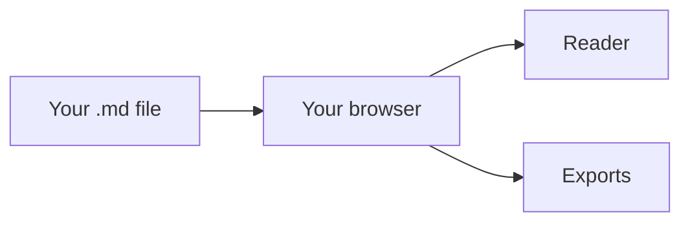

# Introduction

MDAura is a reader for Markdown files. You open a `.md` file and get a document with an outline, search, highlighted code, readable tables and diagrams that draw themselves in. Reading and exporting run in your browser, so the file never leaves your machine.

## Open your first document

1. Go to the [home page](/).
2. Drag a Markdown file onto the drop area, or select **Choose file**.
3. The reader opens. The outline on the left lists every heading in the file.

No account is needed. MDAura is free and open source.

## What happens to your file

The file is read into memory by your browser and rendered there. Nothing is sent to a server.

## Who MDAura is for

- **Engineers** reading design docs, runbooks and READMEs that are too long for a code viewer.
- **People using AI tools** who get Markdown back from ChatGPT, Claude or Cursor and want to read it properly or hand it to someone else.
- **Technical writers and product managers** who keep specs in Markdown and need a Word or PDF copy for people who do not.

## Next steps

- [Opening files](/docs/opening-files) explains folders, images and the size limit.
- [The reader](/docs/reader) covers the outline, search and focus mode.
- [Diagrams](/docs/diagrams) shows what Mermaid can draw and how the full-screen viewer works.
