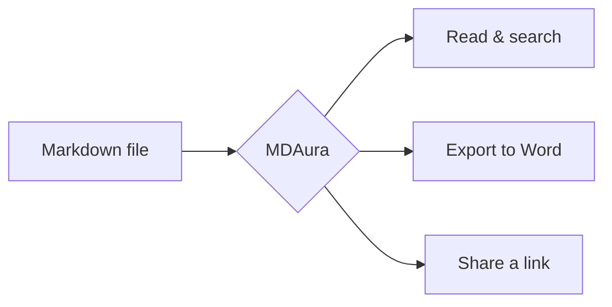

# Welcome to MDAura

MDAura turns any Markdown file into a **navigable, presentation-grade document**. Everything you see here is rendered in your browser — this file was never uploaded.

## What you can do

- Jump around with the **table of contents** on the left (it follows your scroll).
- Press `Ctrl+K` to **search** the whole document.
- Change text size with the **Aa** control, bottom right.
- Export to **Word** from the top bar.

> Tip: hover a heading to copy a deep link to that section.

## Living diagrams

Mermaid diagrams draw themselves in. Hover one for zoom, replay and fullscreen.



## Code that looks right

```ts
export function greet(name: string) {
  return `Hello, ${name}!`;
}
```

## Tables

| Feature | Available | Notes |
|---|---|---|
| Reading and search | Yes | Works offline once loaded |
| Word and PowerPoint export | Yes | Runs in your browser |
| Share links | Coming soon | Export to Word or PDF for now |

## Task lists

- [x] Open a document
- [x] Explore the sidebar
- [ ] Share it with someone

---

That is it. Drop your own `.md` file on the home page to begin.
