# Orbit Platform Engineering Handbook


This handbook describes how the Orbit payments platform is built, deployed, observed and operated. It is the first document a new engineer should read and the last one an on-call engineer should need at 3 a.m.

> **Status:** living document. Every section has an owner in the table below. If something here is wrong, the owner fixes it within one working week.

| Section | Owner | Last reviewed | Review cadence |
|:--|:--|--:|:-:|
| System overview | Platform | 2026-10-12 | Quarterly |
| Services catalogue | Platform | 2026-10-01 | Monthly |
| Payments lifecycle | Payments | 2026-09-28 | Quarterly |
| Data model | Data | 2026-09-14 | Quarterly |
| Delivery pipeline | Developer experience | 2026-10-08 | Quarterly |
| Incident response | SRE | 2026-10-10 | After every SEV-1 |
| Observability | SRE | 2026-09-30 | Quarterly |
| API reference | API guild | 2026-10-11 | Every release |

---

## 1. System overview

Orbit takes card and wallet payments for about 4,200 merchants across 31 countries. At peak it handles **2,850 requests per second** at the edge and settles roughly **€310 million** a month.


### 1.1 Context

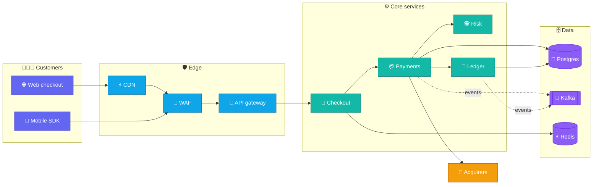

### 1.2 Design principles

1. **Money never moves twice.** Every write that touches funds is idempotent and keyed by the merchant's `Idempotency-Key`.
2. **The ledger is the truth.** Service databases are caches of state; balances come from the double-entry ledger only.
3. **Fail closed on risk, fail open on analytics.** If the risk engine is down we decline; if the analytics pipeline is down we keep taking payments.
4. **Every dependency has a timeout and a budget.** No call waits longer than its share of the 1.2 s checkout budget.
5. **Boring technology first.** Postgres, Kafka and Go cover 95% of what we need.

### 1.3 Latency budget

| Hop | p50 | p95 | Budget | Owner |
|---|--:|--:|--:|---|
| CDN + WAF | 9 ms | 22 ms | 40 ms | Platform |
| API gateway | 4 ms | 11 ms | 20 ms | Platform |
| Checkout | 18 ms | 46 ms | 80 ms | Checkout |
| Risk scoring | 31 ms | 88 ms | 150 ms | Risk |
| Acquirer authorisation | 240 ms | 610 ms | 800 ms | Payments |
| Ledger write | 6 ms | 15 ms | 30 ms | Ledger |
| **Total** | **308 ms** | **792 ms** | **1,120 ms** | |

---

## 2. Services catalogue

| Service | Language | Runtime | Datastore | Tier | On-call rota | Repo |
|---|---|---|---|:-:|---|---|
| `api-gateway` | Go 1.25 | Kubernetes | Redis | 0 | Platform | `orbit/gateway` |
| `checkout` | TypeScript | Kubernetes | Postgres, Redis | 0 | Checkout | `orbit/checkout` |
| `payments` | Go 1.25 | Kubernetes | Postgres | 0 | Payments | `orbit/payments` |
| `risk` | Python 3.13 | Kubernetes + GPU | Feature store | 0 | Risk | `orbit/risk` |
| `ledger` | Go 1.25 | Kubernetes | Postgres (dedicated) | 0 | Ledger | `orbit/ledger` |
| `payouts` | Go 1.25 | Kubernetes | Postgres | 1 | Ledger | `orbit/payouts` |
| `notifications` | TypeScript | Serverless | DynamoDB | 2 | Growth | `orbit/notify` |
| `reporting` | Python 3.13 | Batch (Airflow) | Warehouse | 2 | Data | `orbit/reporting` |
| `merchant-portal` | TypeScript | Edge functions | Postgres | 1 | Merchant | `orbit/portal` |
| `webhooks` | Go 1.25 | Kubernetes | Kafka, Postgres | 1 | Platform | `orbit/webhooks` |
| `fx-rates` | Go 1.25 | Kubernetes | Redis | 1 | Payments | `orbit/fx` |
| `audit-log` | Rust 1.90 | Kubernetes | S3 + Athena | 1 | Security | `orbit/audit` |

**Tier 0** services page someone within five minutes, day or night. **Tier 1** pages during business hours and creates a ticket otherwise. **Tier 2** creates a ticket.

---

## 3. Payments lifecycle

### 3.1 Authorisation request

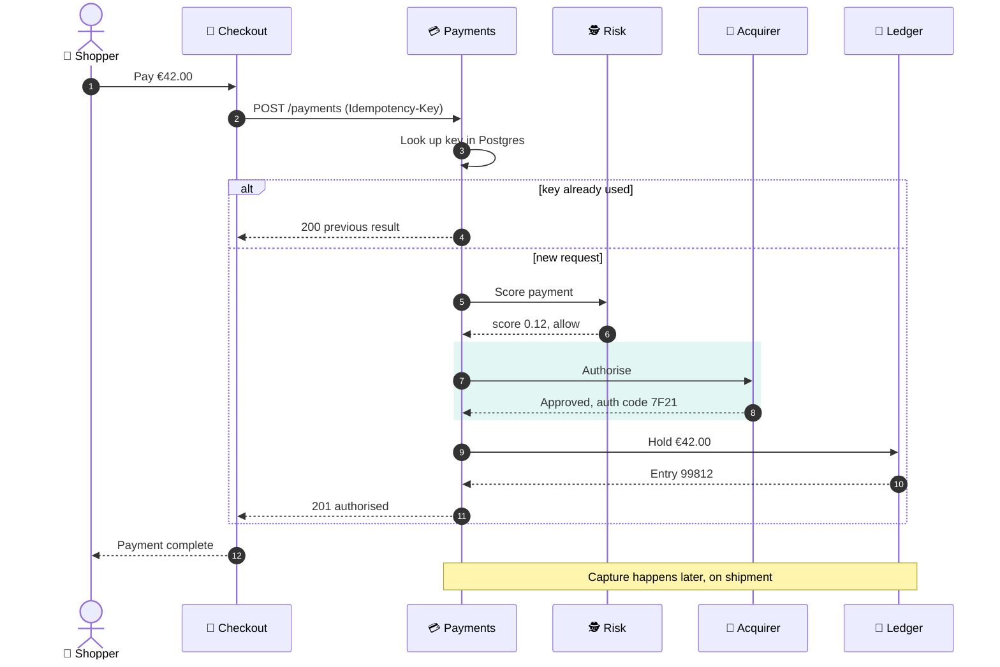

### 3.2 Payment states

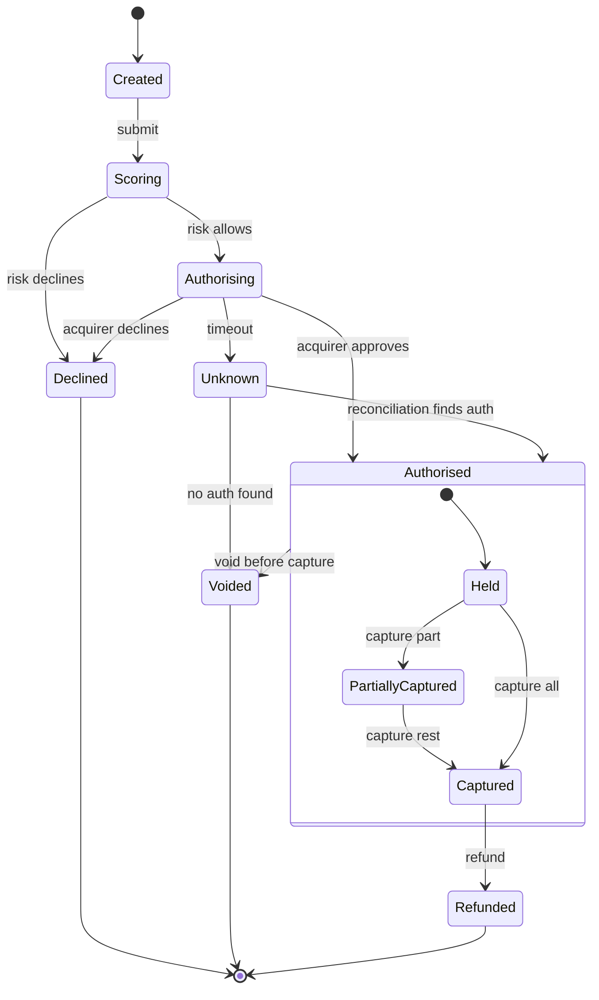

### 3.3 Decline codes

| Code | Meaning | Retry? | Shown to shopper |
|---|---|:-:|---|
| `05` | Do not honour | No | "Your bank declined this payment." |
| `14` | Invalid card number | No | "Check the card number." |
| `51` | Insufficient funds | After 24 h | "Your bank declined this payment." |
| `54` | Expired card | No | "This card has expired." |
| `91` | Issuer unavailable | Yes, once | "Try again in a moment." |
| `R1` | Risk decline | No | "We couldn't take this payment." |

---

## 4. Data model

### 4.1 Core entities

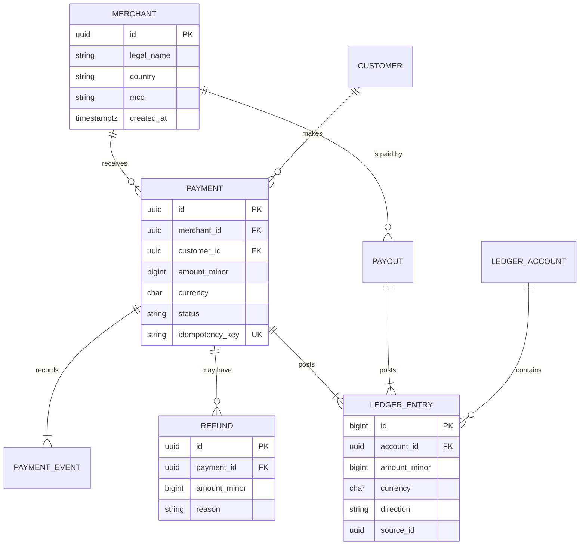

### 4.2 Domain classes

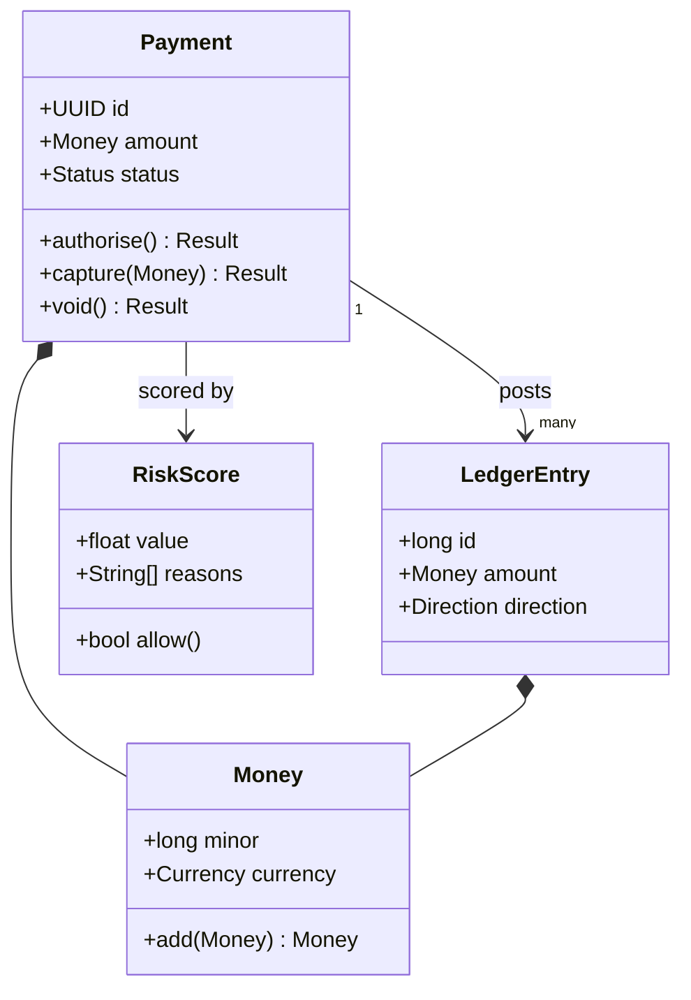

### 4.3 Retention

| Data | Store | Retention | Legal basis |
|---|---|---|---|
| Card numbers | Vault (tokenised) | Until card expiry + 13 months | PCI DSS 4.0 |
| Payments | Postgres, then archive | 10 years | Accounting law |
| Risk features | Feature store | 18 months | Fraud prevention |
| Request logs | Loki | 30 days | Operations |
| Audit log | S3 Object Lock | 7 years | SOC 2 |

---

## 5. Delivery pipeline

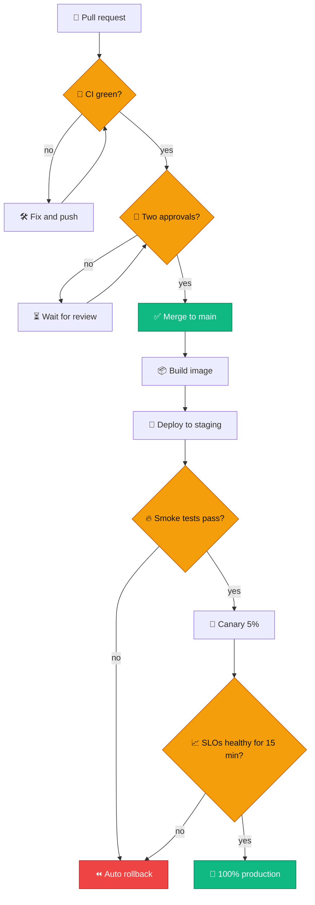

### 5.1 Branching

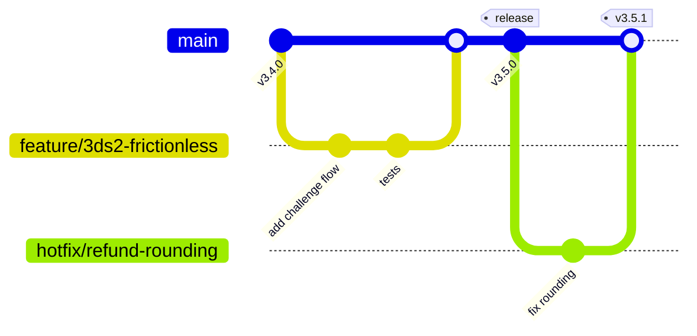

### 5.2 Deploy commands

```bash
# Build and push an image for the current commit
make image SERVICE=payments
make push SERVICE=payments

# Promote the canary once SLOs are green
orbitctl deploy promote payments --from canary --to prod --wait

# Roll back to the previous release
orbitctl deploy rollback payments --to previous --reason "INC-2291"
```

---

## 6. Roadmap

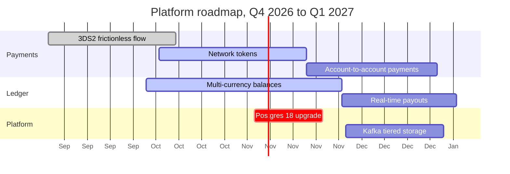

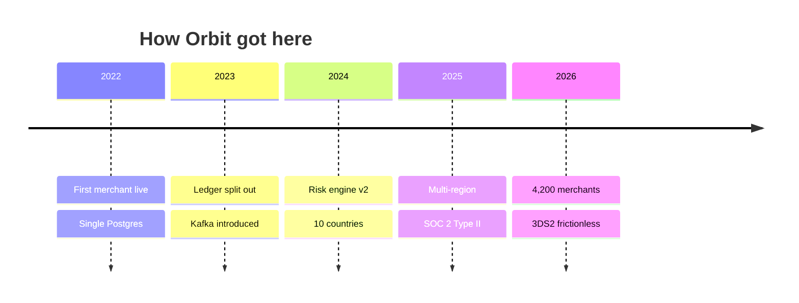

---

## 7. Incident response


### 7.1 Severity levels

| Severity | Definition | Response | Comms |
|---|---|---|---|
| **SEV-1** | Payments failing for more than 5% of traffic, or any data loss | Page everyone on the rota, incident lead within 5 min | Status page within 15 min, every 30 min after |
| **SEV-2** | One tier-0 service degraded, payments still succeeding | Page primary, lead within 15 min | Status page if merchants notice |
| **SEV-3** | Tier-1 or tier-2 service degraded | Ticket, fix in business hours | None |

### 7.2 First fifteen minutes

1. **Acknowledge** the page in PagerDuty so the next person is not paged.
2. **Open a channel** with `/incident new sev2 "Checkout latency"`.
3. **Check the dashboard** for the affected service.
4. **Decide** whether the last deploy is the cause. If unsure, roll back first and investigate after.
5. **Hand off** comms to the comms lead as soon as one joins.

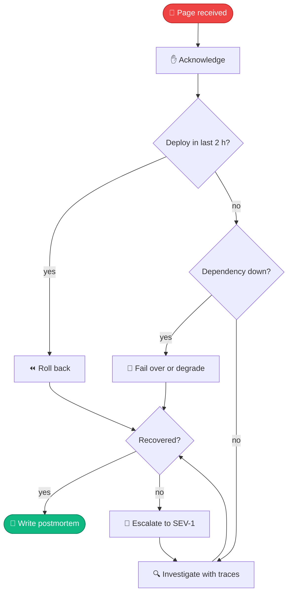

### 7.3 What an incident feels like

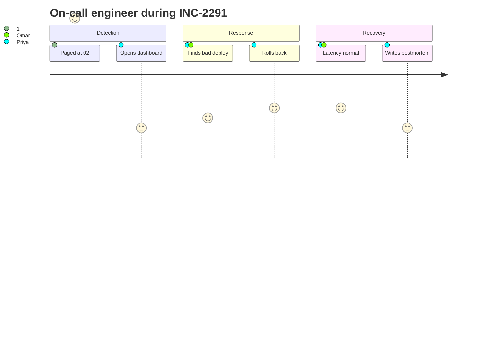

<details>
<summary>Postmortem template</summary>

- **Summary:** one paragraph, no jargon.
- **Impact:** merchants affected, payments failed, money at risk.
- **Timeline:** in UTC, from first signal to all clear.
- **Root cause:** what failed and why it was possible.
- **What went well** and **what did not.**
- **Actions:** each with an owner and a due date.

</details>

---

## 8. Observability


### 8.1 Error budget, September

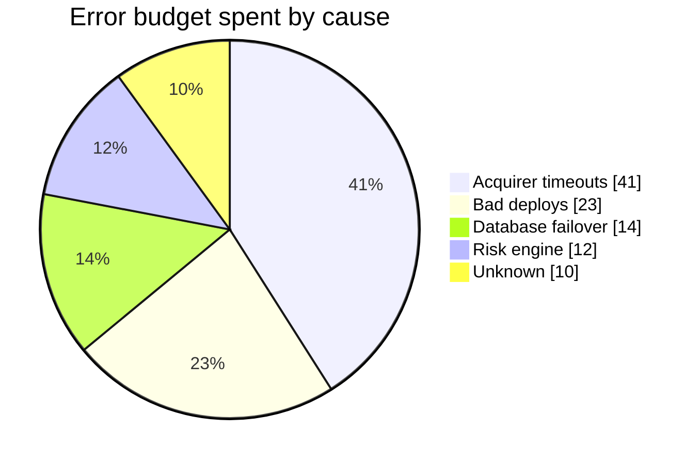

### 8.2 Throughput

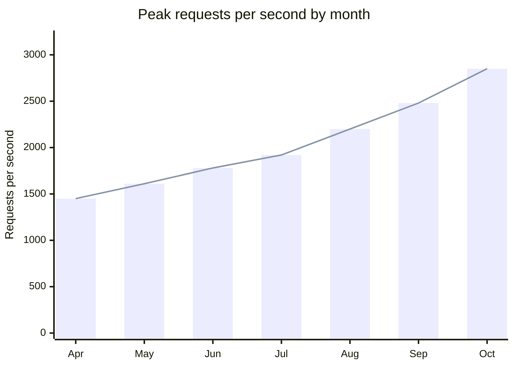

### 8.3 Service level objectives

| Service | SLI | Objective | Window | Current |
|---|---|--:|---|--:|
| Checkout | Successful requests | 99.95% | 28 days | 99.97% |
| Checkout | p95 latency under 300 ms | 99% | 28 days | 98.6% |
| Payments | Authorisations without internal error | 99.99% | 28 days | 99.992% |
| Ledger | Entries written within 1 s | 99.9% | 28 days | 99.95% |
| Webhooks | Delivered within 60 s | 99.5% | 7 days | 99.81% |

---

## 9. Prioritisation

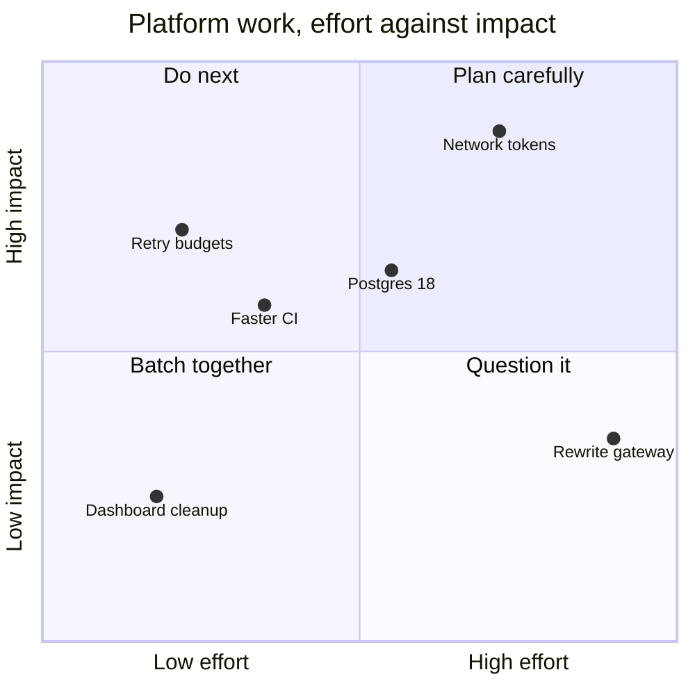

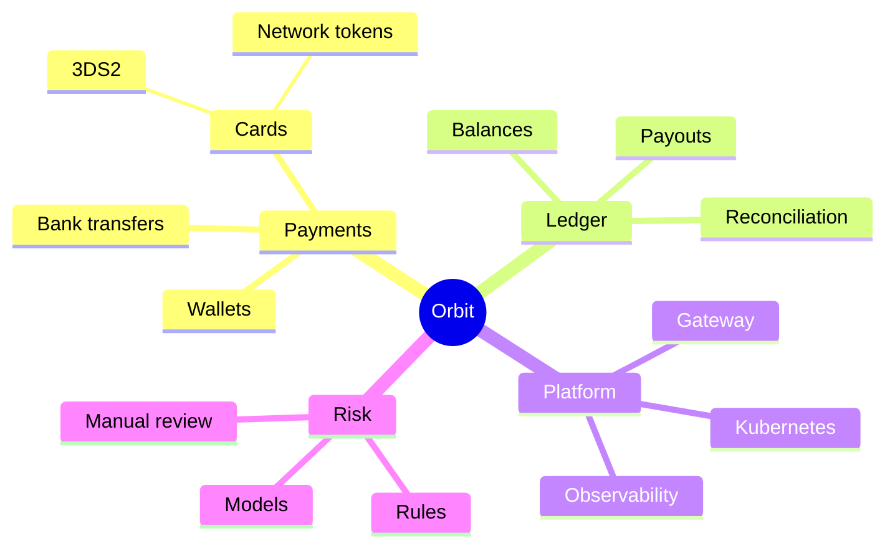

---

## 10. API reference

### 10.1 Endpoints

| Method | Path | Purpose | Idempotent | Rate limit |
|---|---|---|:-:|--:|
| `POST` | `/v3/payments` | Create and authorise a payment | Yes | 300/s |
| `GET` | `/v3/payments/{id}` | Fetch a payment | Yes | 1,000/s |
| `POST` | `/v3/payments/{id}/capture` | Capture an authorised payment | Yes | 300/s |
| `POST` | `/v3/payments/{id}/void` | Void before capture | Yes | 100/s |
| `POST` | `/v3/refunds` | Refund a captured payment | Yes | 100/s |
| `GET` | `/v3/balances` | Current balances by currency | Yes | 50/s |

### 10.2 Create a payment

```http
POST /v3/payments HTTP/1.1
Host: api.orbit.example
Authorization: Bearer sk_test_…
Idempotency-Key: 9f3c2a7e-6c1d-4b0f-9a55-1f2e3d4c5b6a
Content-Type: application/json
```

```json
{
  "amount": { "minor": 4200, "currency": "EUR" },
  "payment_method": "pm_card_visa",
  "capture": "manual",
  "metadata": { "order_id": "A-10293" }
}
```

### 10.3 Client examples

```typescript
import { Orbit } from "@orbit/node";

const orbit = new Orbit(process.env.ORBIT_KEY!);

export async function charge(orderId: string, cents: number) {
  const payment = await orbit.payments.create(
    { amount: { minor: cents, currency: "EUR" }, payment_method: "pm_card_visa", capture: "manual" },
    { idempotencyKey: `order-${orderId}` },
  );
  if (payment.status !== "authorised") throw new Error(`Declined: ${payment.decline_code}`);
  return payment.id;
}
```

```go
func (s *Service) Capture(ctx context.Context, id uuid.UUID, amt Money) error {
	ctx, cancel := context.WithTimeout(ctx, 800*time.Millisecond)
	defer cancel()

	p, err := s.repo.Get(ctx, id)
	if err != nil {
		return fmt.Errorf("load payment %s: %w", id, err)
	}
	if err := p.Capture(amt); err != nil {
		return err
	}
	return s.repo.Save(ctx, p)
}
```

```python
from decimal import Decimal

def to_minor(amount: Decimal, currency: str) -> int:
    """Convert a decimal amount to minor units, respecting zero-decimal currencies."""
    exponent = {"JPY": 0, "KRW": 0, "BHD": 3}.get(currency, 2)
    return int((amount * (10 ** exponent)).quantize(Decimal(1)))
```

```sql
-- Daily settled volume by currency, last 7 days
SELECT date_trunc('day', captured_at) AS day,
       currency,
       sum(amount_minor) / 100.0       AS volume
FROM   payments
WHERE  status = 'captured'
  AND  captured_at >= now() - interval '7 days'
GROUP  BY 1, 2
ORDER  BY 1 DESC, 3 DESC;
```

```yaml
# deploy/payments/values.yaml
replicas: 12
resources:
  requests: { cpu: "750m", memory: "1Gi" }
  limits: { memory: "2Gi" }
rollout:
  canary: { weight: 5, analysis: slo-healthy, durationMinutes: 15 }
```

---

## 11. Onboarding checklist

- [x] Laptop set up with `orbit-bootstrap`
- [x] Access to GitHub, PagerDuty and Grafana
- [ ] Read sections 1 to 3 of this handbook
- [ ] Shadow one on-call shift
- [ ] Ship a change to staging
  - [ ] Pair with a reviewer from your team
  - [ ] Watch it through the canary

---

## Appendix A. Glossary

| Term | Meaning |
|---|---|
| **Acquirer** | The bank that processes card payments on the merchant's behalf. |
| **Authorisation** | The issuer's promise to pay; money is reserved but not moved. |
| **Capture** | Asking for the authorised money to actually be moved. |
| **Idempotency key** | A client-supplied key that makes retries safe. |
| **Minor units** | The smallest unit of a currency, such as cents. |
| **SLO** | Service level objective, the reliability target we promise ourselves. |
| **3DS2** | 3-D Secure 2, the protocol for strong customer authentication. |

## Appendix B. External image

This image loads from another site, to test remote images:


## Appendix C. Notes

The latency budget in section 1.3 excludes the shopper's network.[^net] Decline messages follow the card schemes' guidance on not revealing fraud signals.[^schemes]

Text formatting check: **bold**, *italic*, ***both***, ~~struck~~, `code`, <kbd>Ctrl</kbd> + <kbd>K</kbd>, H<sub>2</sub>O and E = mc<sup>2</sup>.

[^net]: Measured from the CDN edge to the response leaving the gateway.
[^schemes]: Visa and Mastercard both recommend a generic message for codes `05` and `51`.
