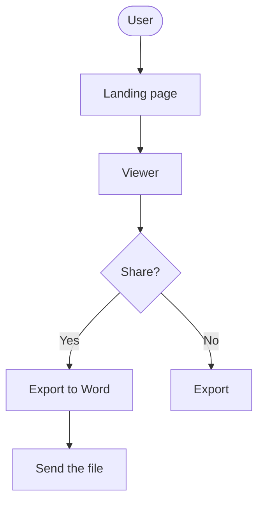
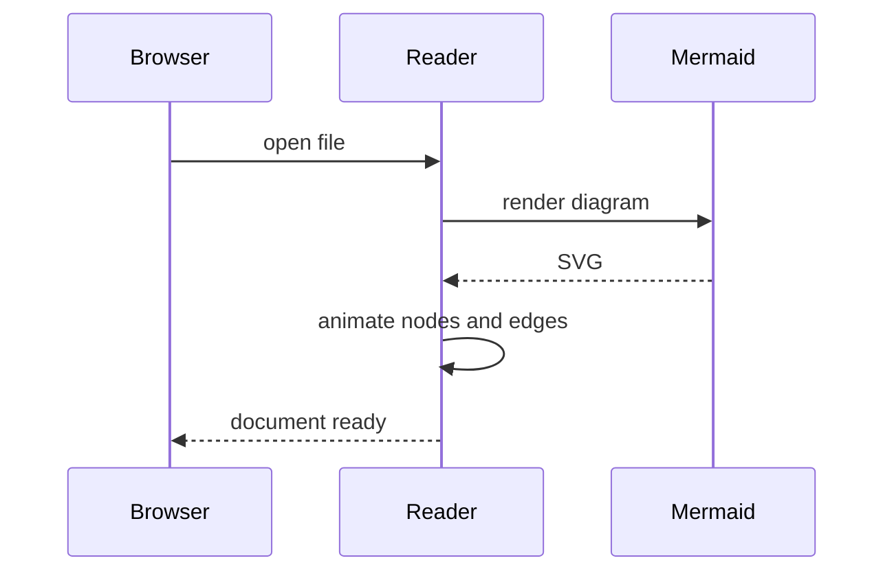
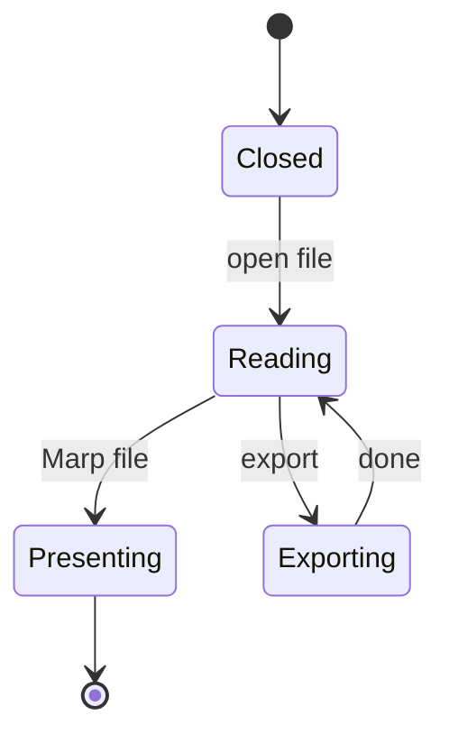
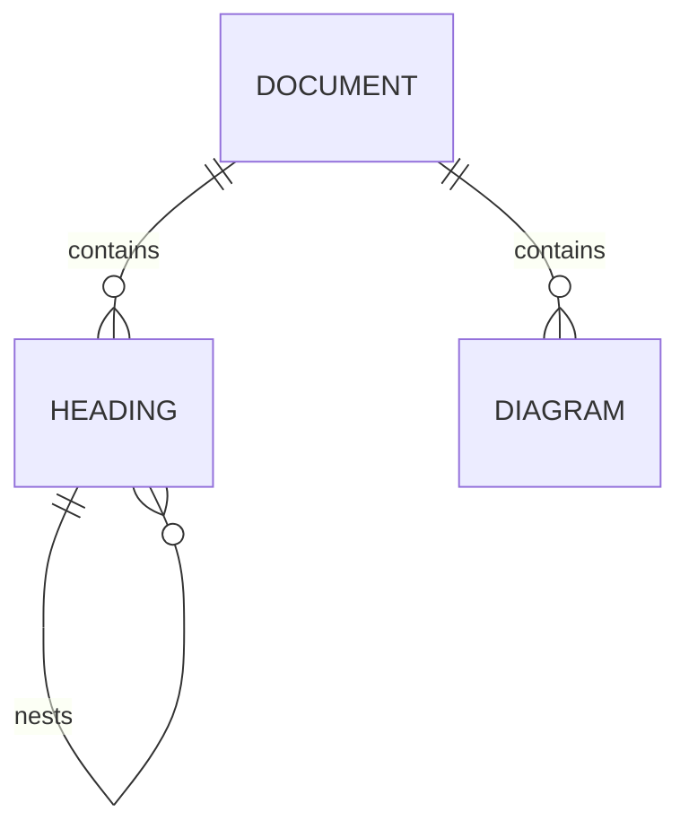
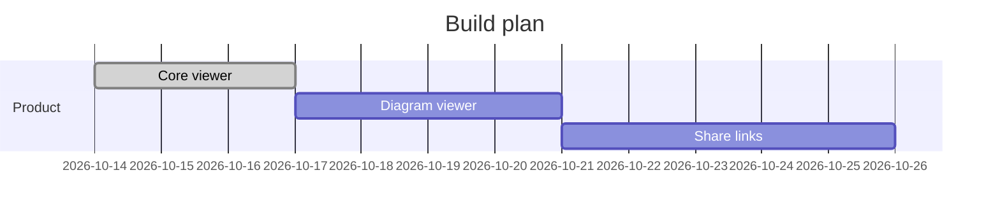
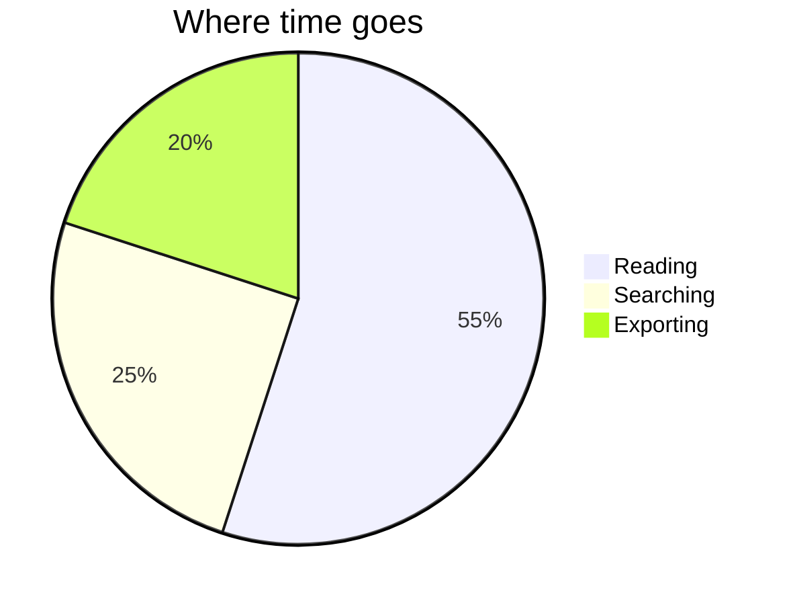

# Animated Diagrams

Every diagram below reveals itself: nodes blur in, connectors draw, and a glowing bead flows along flowchart edges. Use the **▶ replay** button on any diagram.

## Flowchart

## Sequence

## State

## Entity relationship

## Timeline of work

## Pie

